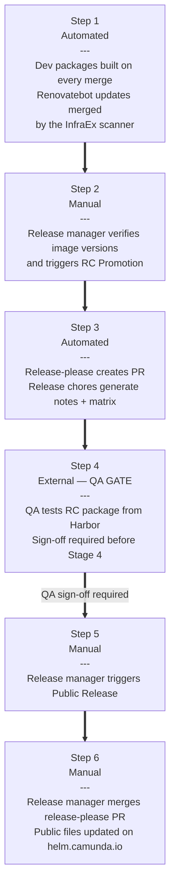

This document is for Distro team maintainers. For contribution process, see the [Maintainer Guide](../maintainer-guide.md).

The charts are built, linted, and tested on every push to the main branch. The release process follows a **3-stage pipeline** that ensures the exact artifact tested by QA is what gets publicly released — no rebuilding at release time.

## Architecture Overview

```
┌─────────────────────┐     ┌─────────────────────┐     ┌─────────────────────┐     ┌─────────────────────┐
│  1. DEV BUILD       │     │  2. RC PROMOTION    │     │  3. QA GATE         │     │  4. PUBLIC RELEASE  │
│  (Every merge)      │ ──► │  (Manual trigger)   │ ──► │  (External)         │ ──► │  (Manual trigger)   │
├─────────────────────┤     ├─────────────────────┤     ├─────────────────────┤     ├─────────────────────┤
│ • Build dev package │     │ • Retag dev → RC    │     │ • QA validates RC   │     │ • Pull RC from      │
│ • Push to Harbor    │     │ • Create release-   │     │   from Harbor       │     │   Harbor            │
│ • Cosign signing    │     │   please PR         │     │ • Sign-off required │     │ • Publish to GitHub │
└─────────────────────┘     └─────────────────────┘     │   before Stage 4    │     │   Releases          │
        ↓                           ↓                    └─────────────────────┘     │ • Cosign signing    │
   Harbor (internal)          Harbor (retag only)                  ↓                 └─────────────────────┘
   {version}-dev-{sha}        {version}-rc               QA approval required                  ↓
                                                                                       GitHub Releases
                                                                                       helm.camunda.io
```

## Registries

| Registry | Purpose | Access |
|---|---|---|
| **Harbor** (`registry.camunda.cloud/team-distribution`) | Internal dev/RC storage | Internal only |
| **GitHub Releases** (`helm.camunda.io`) | Public releases | Public |

## Release Pipeline

### Stage 1: Dev Package Build

**Workflow:** [`chart-build-dev.yaml`](https://github.com/camunda/camunda-platform-helm/blob/main/.github/workflows/chart-build-dev.yaml)

**Trigger:** Automatic on every merge to `main` (for paths: `charts/camunda-platform-*/**`).

**What happens:**

1. Builds dev packages for all chart versions selected by `chartAutomation.routineVersions`.
2. Computes the release version using `release-please --dry-run`.
3. Applies release transformations (removes dev comments, badges).
4. Generates release notes using the `release-tools release-notes` command.
5. Packages the chart with the **final release version** in `Chart.yaml`.
6. Pushes to Harbor with dev tags.
7. Signs with Cosign.

**Tagging scheme:**

| Tag | Example | Purpose |
|---|---|---|
| `{version}-dev-{sha}` | `13.4.0-dev-abc1234` | Immutable, traceable to commit |
| `{chart-major}-dev-latest` | `13-dev-latest` | Rolling, always points to latest |

**Workflow summary** shows:

- Package location and tags.
- All component image versions (from `values.yaml`).
- Cosign verification status.

> **Note:** The `Chart.yaml` inside the package contains the **real release version** (e.g. `13.4.0`), not the dev tag. This is computed via `release-please` dry-run at build time.

### Stage 2: RC Promotion

**Workflow:** [`chart-promote-rc.yaml`](https://github.com/camunda/camunda-platform-helm/blob/main/.github/workflows/chart-promote-rc.yaml)

**Trigger:** Manual `workflow_dispatch` with input:

- `dev-tag`: The dev package to promote (e.g. `13.4.0-dev-abc1234` or `13-dev-latest`).

**What happens:**

1. Resolves rolling tags to actual dev tags via the Harbor API.
2. Validates the commit is on the `main` branch.
3. Runs `release-please release-pr` to create/update the release PR.
4. Adds RC tags to the **same artifact** in Harbor (no rebuild!).

**Tagging scheme:**

| Tag | Example | Purpose |
|---|---|---|
| `{version}-rc` | `13.4.0-rc` | Immutable RC tag |
| `{chart-major}-rc-latest` | `13-rc-latest` | Rolling, always points to latest RC |

**Release-Please PR:**

- Updates `Chart.yaml` version and changelog annotations.
- Updates `.release-please-manifest.json`.
- The promotion workflow generates the release files on the PR from the dev
  package: `RELEASE-NOTES.md`, the `Chart.yaml` release annotations, and the
  version matrix files (component versions mapping + READMEs).

### Stage 3: Public Release

**Workflow:** [`chart-release-public.yaml`](https://github.com/camunda/camunda-platform-helm/blob/main/.github/workflows/chart-release-public.yaml)

**Trigger:** Manual `workflow_dispatch` with input:

- `rc-tag`: The RC package to release (e.g. `13.4.0-rc` or `13-rc-latest`).

**What happens:**

1. Pulls the RC package from Harbor.
2. Extracts metadata (version, app version) from the packaged `Chart.yaml`.
3. Uploads to GitHub Releases using `helm-cr`.
4. Updates the Helm repo index (`gh-pages` branch).
5. Signs with Cosign and uploads the bundle to the release.
6. Stamps the published release's date onto the chart's `version-matrix.json` entry
   (`release-tools stamp-release`) and regenerates the matrix READMEs on the `release-please`
   branch — the single write of `release_date`, taken from the GitHub release's `publishedAt`.
7. Labels the `release-please` PR with `autorelease: published`.

**Release tag format:** `camunda-platform-{appVersion}-{version}` (e.g. `camunda-platform-8.8-13.4.0`).

**After public release:**

1. The workflow enables auto-merge on the `release-please` PR, then shepherds it through the merge
   queue (re-enabling auto-merge after evictions). If it still does not merge within the timeout, a
   distinct Slack alert pings the distribution release manager to merge it manually — the release
   itself is not treated as failed.
2. Merging the `release-please` PR syncs `main` with the released artifact and triggers `chart-public-files.yaml` to update:
   - [Version matrix](https://helm.camunda.io/camunda-platform/version-matrix/) (component versions for each chart release).
   - Public values files at `helm.camunda.io/camunda-platform/values/`.

## Helm-Only Ad-Hoc Release

Use this process when a Helm Chart fix is needed (e.g. incorrect image tag, chart misconfiguration) and no application components need to be re-released. It requests an ad-hoc release train scoped to **HC** (Helm Chart) only, rather than a full multi-component train.

### When to Use

- A released Helm Chart contains an error (e.g. wrong image tag, misconfigured value).
- The fix is limited to the Helm Chart — no new application component versions are involved.
- A full multi-component release train would be overkill.

### Steps

1. **Make sure the fix is merged to `main` and a dev package was built** — the post-merge build is automatic; manually trigger [`chart-build-dev.yaml`](https://github.com/camunda/camunda-platform-helm/blob/main/.github/workflows/chart-build-dev.yaml) only if it hasn't run yet, or if you need to pin specific component image versions rather than taking the latest.

2. **Request the ad-hoc release train** — In [`#top-c8-release-train`](https://camunda.slack.com/archives/C03NFMH4KC6), trigger the **"Ad-Hoc Release Train Request"** Slack workflow. Fill in:
   - Reason for the ad-hoc release (link the Jira/support ticket).
   - Which minor version(s) are included (e.g. `8.9`).
   - Due date.
   - Released artifact — select **HC** (Helm Chart) only; do not select other components.

   Submitting posts a formatted announcement in the channel that pings the release train manager. This is a request, not a self-service trigger: the release train manager makes the final call and coordinates whether other components join. RC promotion, QA testing, the public release, and the release-please PR merge are all automated on your side and require no further manual action once the train is kicked off.

### Notes

- **Chart versioning:** the release version is determined by the workflows — [`chart-build-dev.yaml`](https://github.com/camunda/camunda-platform-helm/blob/main/.github/workflows/chart-build-dev.yaml) derives the version from a release-please dry-run (falling back to the current `Chart.yaml` version), and [`chart-promote-rc.yaml`](https://github.com/camunda/camunda-platform-helm/blob/main/.github/workflows/chart-promote-rc.yaml) forces `--release-as` to the version parsed from the selected dev tag.
- This process is for Self-Managed only — no SaaS rollout is involved.

## Release Process Flowchart



## Version Tagging Summary

| Stage | OCI Tag | `Chart.yaml` Version | Registry |
|---|---|---|---|
| Dev | `{version}-dev-{sha}` | `{version}` | Harbor |
| RC | `{version}-rc` | `{version}` | Harbor |
| Public | N/A (GitHub Release) | `{version}` | GitHub Releases |

**Camunda version derivation:** The Helm chart major version maps to a Camunda version:

- `11.x` = Camunda 8.6
- `12.x` = Camunda 8.7
- `13.x` = Camunda 8.8
- `14.x` = Camunda 8.9
- `15.x` = Camunda 8.10
- `16.x` = Camunda 8.11

## Routine Chart Automation

`chartAutomation.routineVersions` in [`charts/chart-versions.yaml`](https://github.com/camunda/camunda-platform-helm/blob/main/charts/chart-versions.yaml) selects routine CI, dev packaging, artifact verification, and maintenance chores. Lifecycle metadata is independent and controls the existing version-matrix display. An ESUP case requires routine Helm chart automation only when its agreed delivery scope includes that maintenance; component-only cases can use explicit ad-hoc validation without joining the routine list.

## Minor Version Chores

A minor goes through two sets of chores at different times. The examples use `8.10` as the minor that becomes GA and `8.11` as the new alpha.

### New alpha chart

Do these steps when you create the new alpha chart. The examples copy `8.10` to `8.11` as chart `16.0.0-alpha0`. Copy the checklist into the tracking issue of the cut.

The [`chart-minor-cut`](../../.claude/skills/chart-minor-cut/SKILL.md) skill has the commands and the check for each step. Its section numbers match the steps below.

- [ ] **1. State of the previous minor.** Record if `8.10` has `released` in [`charts/chart-versions.yaml`](https://github.com/camunda/camunda-platform-helm/blob/main/charts/chart-versions.yaml). Step 7 needs it.
- [ ] **2. Version-agnostic tooling.** Search outside `charts/` for hardcoded `8.10` lists. Change substring checks and fixed lists to numeric comparisons, or add `8.11`. Merge these fixes in a separate PR first.
- [ ] **3. Copy.** Copy the tracked files of `charts/camunda-platform-8.10` with `git ls-files`, not with `cp -r`. Check that both directories have the same number of tracked files.
- [ ] **4. Chart metadata.** Set `version: 16.0.0-alpha0` and `appVersion: 8.11.x`. Add `artifacthub.io/prerelease: "true"`. Reset `artifacthub.io/changes`, `CHANGELOG.md` and `RELEASE-NOTES.md`. The dev build adds one to the alpha number, so the first release is `-alpha1`.
- [ ] **5. Image tags.** Replace every `8.10` tag in `values.yaml`, `values-latest.yaml` and `values-digest.yaml`. Use `8.11-SNAPSHOT` where Docker Hub has it, else `SNAPSHOT`. Pin the digests. Set the `values-latest.yaml` header to `Camunda - Alpha`.
- [ ] **6. Audit the copy.** Search the new chart for `8.10`, `8.9` and old chart directory names. Keep history statements. Fix docs links, the release-highlights text, README directory names, the Playwright `SM-8.11` suite, test values headers, Hub cluster versions and registry paths. Remove the hooks of the `8.9` to `8.10` upgrade.
- [ ] **7. Wiring.** Add `8.11` to `routineVersions` and `camundaSupportLifecycle` (without `released`). Add the release-please package (with the `version/alpha` label) and the manifest entry (with the filler entry). Add `8.11` to the Renovate alpha and digest rules, `pr-labeler.yaml`, `permitted-flows.yaml`, the `test-chart-version.yaml` choices, `test-release-tooling.yaml`, `inject_values.go`, `render-e2e-env.sh` and the version map above. Create the `version/8.11` label. If `8.10` is not GA yet, also deny `upgrade-minor` for `8.11`. Remove that deny when `8.10` becomes GA.
- [ ] **8. Regenerate.** Run `helm.dependency-update`, `helm.readme-update`, `helm.schema-update` and `go.update-golden-only` for the new chart.
- [ ] **9. Checks.** Lint and unit tests pass for the new chart. The tooling tests pass. `release-tools release-version` returns `16.0.0-alpha1`. The rendered images use the new tags. The `8.10` chart has no changes. The tier-1 scenarios pass.
- [ ] **10. PR.** Open `feat: create the Camunda 8.11 Helm chart line as 16.0.0-alpha0`. Stack it on the tooling PR if that PR is not merged.
- [ ] **11. After the merge.** Push the annotated tag `camunda-platform-8.11-16.0.0-alpha0` on the merge commit. Without it, the first alpha release fails. Check that the first dev build makes `16.0.0-alpha1`. Tell QA (the `SM-8.11` e2e suite) and the monorepo team (the preview-environment smoke test).
- [ ] **12. Older minors.** Check the end of standard maintenance and the ESUP cases of each older minor. Move or end them in separate PRs, not in the cut PR.

### Minor becoming GA

The release train publishes the Helm chart before the official release date. Do steps 1–10 before the train starts the Helm chart build (`chart-build-dev.yaml` with `chart-version: 8.10`). The distribution release manager owns these steps and the checks after the public release.

1. Label all open PRs with `backport-to-latest` so that contributors know their PRs need updating.
2. In `charts/chart-versions.yaml`, set `released` and `stdSupportUntil` for `8.10`. Use the "Minor release date" and "End of standard maintenance" dates from the 8.10 release announcements page in the docs. The presence of `released` switches the release tooling from prerelease to stable versions. Without `stdSupportUntil`, the version matrix shows the minor in extended support.
3. Do not change the version in `Chart.yaml`. The dev build computes the GA version from `chart-versions.yaml`, and the release-please PR writes it to `Chart.yaml`. If you set `Chart.yaml` to the GA version by hand, the dev build takes the next version from release-please instead.
4. Remove `artifacthub.io/prerelease: "true"` from `charts/camunda-platform-8.10/Chart.yaml`. A published chart cannot be changed, and Artifact Hub keeps the prerelease flag of a published version.
5. Set the GA image tags in `values.yaml`, `values-latest.yaml` and `values-digest.yaml`, and change the `values-latest.yaml` header from `Camunda - Alpha` to `Camunda Helm chart.`. Renovate and CI read these files from `main`, and the package ships `values-digest.yaml` as it is on `main`.
   - In `values-digest.yaml`, pin each image to the digest of its GA tag. Docker Hub returns the digest in the `digest` field of `https://hub.docker.com/v2/repositories/<image>/tags/<tag>` (for example `camunda/camunda` and `8.10.0`).
   - Remove the values of components that the GA chart does not ship (for 8.10, the Console block in `values-latest.yaml`).
6. In `renovate.json5`, move the `8.10` files from the alpha rules to the patch-only `camunda-platform-images` group. Keep the alpha rules. Leave their `matchFileNames` empty until the next alpha chart exists.
7. Remove the `version/alpha` label from the `8.10` package in `.github/config/release-please/release-please-config.json`.
8. Point the release highlights in `templates/common/_helpers.tpl` at the versioned upgrade guide (`https://docs.camunda.io/docs/8.10/self-managed/upgrade/helm/890-to-8100/`). Remove "alpha" from parameter descriptions.
9. Regenerate the generated files with `make helm.readme-update`, `make helm.schema-update` and `make go.update-golden-only`, each with `chartPath=charts/camunda-platform-8.10`.
10. Render the chart with `values.yaml` only, and again with `-f values-digest.yaml`. Check that every Camunda image uses the GA tag or its digest, and that `app.kubernetes.io/version` shows the GA version. With `values-digest.yaml`, the label shows the chart `appVersion` until [#7440](https://github.com/camunda/camunda-platform-helm/issues/7440) is fixed.
11. Rehearse the release from the PR branch before you merge: run [`chart-promote-rc.yaml`](https://github.com/camunda/camunda-platform-helm/blob/main/.github/workflows/chart-promote-rc.yaml) with `--ref <branch>`, `dev-tag: 15-dev-latest` and `dry-run: true`, then [`chart-release-public.yaml`](https://github.com/camunda/camunda-platform-helm/blob/main/.github/workflows/chart-release-public.yaml) with `--ref <branch>`, `rc-tag: 15-rc-dryrun-latest` and `dry-run: true`. The workflows build the release tooling from the branch. The dev tag must point to a commit on `main`.
12. After the merge, check that the next 8.10 dev build has no `-alpha` suffix in its dev tag.

After the public release:

1. Check that Artifact Hub does not show `15.0.0` as a pre-release.
2. Check that the PRs in the release have the `version:8.10-15.0.0` label.
3. Check the public values files and the version matrix on `helm.camunda.io`.

## Artifact Hub

The [Camunda repo](https://artifacthub.io/packages/search?repo=camunda) is configured on Artifact Hub. After a release, Artifact Hub automatically scans and indexes the new version.

> **Note:** Charts may take up to 30 minutes to appear on Artifact Hub. After successful release, charts are immediately available via [`helm.camunda.io`](https://helm.camunda.io).

## Troubleshooting

### Dev package not found

If RC promotion fails because the dev package doesn't exist:

1. Check if the commit SHA is correct.
2. Verify the dev build workflow succeeded for that commit.
3. Check Harbor directly for available tags.

### Release-Please PR not created

If the RC promotion workflow doesn't create a `release-please` PR:

1. Check for existing unmerged `release-please` PRs with the `autorelease: pending` label.
2. Verify there are releasable commits (conventional commit format required).
3. Check the `release-please` logs for errors.

### Release already exists

If the public release fails because the release tag already exists:

1. Delete the existing release: `gh release delete <tag> --yes`.
2. Re-run the public release workflow.

### Image version mismatch

Before promoting to RC, verify component image versions match the release train:

1. Check the dev build workflow summary for image versions.
2. Compare with the release train announcement (Slack/Tasklist).
3. If there's a mismatch:
   - **Option A:** Wait for the Renovatebot PR. The [InfraEx dependency scanner](https://github.com/camunda/team-infrastructure-experience/blob/main/.github/workflows/renovate-dependency-scan.yml) approves it and adds it to the merge queue every 30 minutes, after its checks pass. A PR labelled `upgrade:major`, `security` or `no merge` needs a human approval.
   - **Option B:** Manually trigger `chart-build-dev.yaml` with specific image tag inputs (the workflow supports overriding individual component versions).
   - **Option C:** Manually create a PR to update `values.yaml`.

## Related Workflows

| Workflow | Purpose |
|---|---|
| [`chart-build-dev.yaml`](https://github.com/camunda/camunda-platform-helm/blob/main/.github/workflows/chart-build-dev.yaml) | Stage 1: Build dev packages |
| [`chart-promote-rc.yaml`](https://github.com/camunda/camunda-platform-helm/blob/main/.github/workflows/chart-promote-rc.yaml) | Stage 2: Promote dev → RC |
| [`chart-release-public.yaml`](https://github.com/camunda/camunda-platform-helm/blob/main/.github/workflows/chart-release-public.yaml) | Stage 3: Publish to GitHub Releases |
| [`chart-release-artifact-verify.yaml`](https://github.com/camunda/camunda-platform-helm/blob/main/.github/workflows/chart-release-artifact-verify.yaml) | Daily Cosign verification |
| [`chart-public-files.yaml`](https://github.com/camunda/camunda-platform-helm/blob/main/.github/workflows/chart-public-files.yaml) | Update public docs after PR merge |

## Release Process Change Policy

Avoid surprises during releases by ensuring all release-affecting changes are communicated clearly and early.

Requirements:

- Communicate before the change goes live.
- Announce in [`#top-c8-release-train`](https://camunda.slack.com/archives/C03NFMH4KC6) and CC:
  - `@monorepo-release-manager`
  - `@qa-release-manager`
  - Others if relevant
